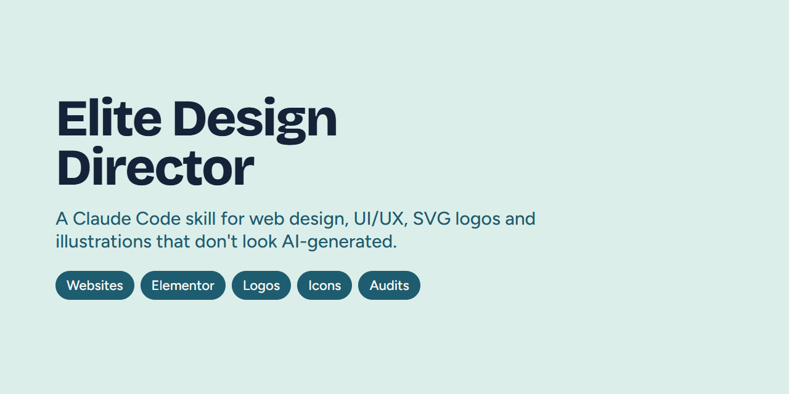

<div align="center">

# Elite Design Director

### Make Claude design websites that don't look AI-generated.

A [Claude Code](https://claude.com/claude-code) skill that works as **creative director**, **product designer** and **design engineer**.<br>
Websites · Landing pages · Dashboards · Elementor · SVG logos · Illustrations · Icon systems

<br>

[](LICENSE)
[](https://claude.com/claude-code)
[](#install)
[](#use)
[](https://github.com/GenAIwithMS/elite-design-director/stargazers)

**[Install](#install)** &nbsp;·&nbsp; **[Use](#use)** &nbsp;·&nbsp; **[Why use it](#why-use-it)** &nbsp;·&nbsp; **[Features](#features)** &nbsp;·&nbsp; **[FAQ](#faq)**



</div>

<br>

It designs websites, landing pages, sections, dashboards and components, and draws logos, SVG illustrations and icon sets. It is built to avoid the generic "AI-made" look, and it checks its own work in a real browser.

## What it does
- **Designs** full sites, landing pages, single sections, dashboards, components and design systems, on any stack: HTML/CSS, React/Next.js, Tailwind, WordPress/Elementor, WooCommerce or Shopify.
- **Improves** existing designs through critique, audit, redesign and polish modes, plus focused modes: `bolder`, `quieter`, `distill`, `harden`, `colorize`, `typeset`, `animate`, `adapt` and `delight`.
- **Vector engine:** logos with a favicon and web-icon kit, hand-authored SVG illustrations, consistent icon sets, and raster-to-SVG tracing.
- **Anti-generic design:** every choice is tied to the brand, a "same-prompt test" catches look-alike plans, and a history log stops the skill from repeating its own house style across projects.
- **Verifies by looking:** headless-browser screenshots at real widths, keyboard and contrast checks, font loading checks, a scanner for generic "AI tells", SVG validation, a calibrated 12-point scorecard and an optional fresh-eyes reviewer.

## Install
Requirements: Claude Code, Node.js 22+, and Chrome or Edge (for the checking scripts). Python 3 with Pillow is needed only for `trace.py`. No npm packages and no paid APIs.

```sh
git clone https://github.com/khizerahmadchohan/elite-design-director.git
cd elite-design-director
./install.sh          # macOS / Linux / Git Bash
.\install.ps1         # Windows PowerShell
```
Or copy the `elite-design-director/` folder to `~/.claude/skills/` yourself. Restart Claude Code afterwards.

## Use
```
/elite-design-director <mode> <what you want>
```
| Goal | Example |
|---|---|
| New site / page | `/elite-design-director landing page for a dental clinic` |
| One section | `/elite-design-director section pricing with 3 plans` |
| Fix an existing design | `/elite-design-director critique https://example.com` |
| Polish | `/elite-design-director polish` (attach a screenshot) |
| Logo | `/elite-design-director logo "Brand Name", what the business does` |
| Illustration / icons | `/elite-design-director illustration office scene for the hero` |
| Raster to SVG | `/elite-design-director trace logo.png` |
| Elementor | `/elite-design-director elementor about page` |

Plain language works too, for example "make this page look less generic".

**Tips:** give it the brand name, audience, any fixed colors or fonts, a reference site you like, and real content. It never invents testimonials, prices or metrics; it marks placeholders instead.

## Why use it
| Problem with AI-generated design | What this skill does |
|---|---|
| Every site looks the same (purple gradients, Inter, three icon cards) | Ties each choice to the brand. A "same-prompt test" and a weighted AI-tell scanner catch generic plans |
| "Looks fine" in code, broken on mobile | Takes real browser screenshots at 390 / 768 / 1024 / 1280 / 1440 px |
| Poor accessibility | Keyboard tab walk, contrast ratios, font loading, heading and landmark checks |
| Fake testimonials and stats | Never invents proof; marks placeholders |
| New sections don't match the site | Builds a site language sheet and runs consistency audits |
| Bitmap "SVGs" and messy logos | Hand-authored vector paths, an SVG validator, favicon and web-icon kits |

## Features
- **Website design:** landing pages, homepages, multi-page sites, hero, pricing, services, testimonials, about, contact and footer sections
- **UI/UX design:** dashboards, admin panels, components, forms, design tokens, DESIGN.md
- **Design critique and audit:** a 12-dimension scorecard with hard quality gates
- **Logo design:** SVG logo concepts, wordmarks, monograms, favicon.ico, apple-touch icons, webmanifest
- **SVG illustration:** layered, editable, themeable illustrations
- **Icon systems:** consistent stroke and grid rules, contact sheets at 16–256 px
- **Raster to vector:** PNG/JPG logo to clean SVG paths (Pillow only)
- **WordPress / Elementor / WooCommerce:** native Elementor building, Globals, SVG upload guidance
- **Platforms:** HTML/CSS, React, Next.js, Tailwind CSS, Shopify
- **Tooling:** local Node scripts (`shoot`, `slopscan`, `palette`, `svgcheck`, `svgexport`, `refgrab`) and Python `trace.py`. No npm packages, no paid APIs

## FAQ
**What is a Claude Code skill?** A folder of instructions and scripts that Claude Code loads on demand. This one turns Claude into a design director.

**Does it work with Claude.ai or the API?** It is built for Claude Code (CLI, desktop, VS Code and JetBrains). The reference files are plain Markdown and can be adapted elsewhere.

**Will it change my live website?** No. It drafts and previews first and needs your explicit permission to publish.

**Does it copy other designs?** No. References are for research only; output is original.

**Do I need an API key or paid tools?** No. Everything runs locally with Node.js and Chrome or Edge.

## Safety rules built in
- It never edits or publishes live websites without your explicit permission.
- It never bypasses login walls or CAPTCHAs.
- It uses references for inspiration only and never copies copyrighted designs.
- It never calls paid APIs without your consent.

## Layout
`elite-design-director/` holds `SKILL.md` (entry and routing), `references/`, `workflows/`, `checklists/`, `agents/`, `scripts/` and `research/` (sources and licensing).

## Contributing
Issues and pull requests are welcome: new tells for the scanner, better references, bug fixes in the scripts. If the skill helped you, please give the repo a ⭐ so others can find it.

## License
MIT. See [LICENSE](LICENSE) and [NOTICE](NOTICE). Credits for the ideas adapted from other open-source projects are in `elite-design-director/research/licensing-and-attribution.md`.
